# Лабораторная работа №2: HTTP-методы: GET, POST, PUT, DELETE

**Студент:** Коровин Максим Александрович<br>
**Группа:** ПИЖ-б-о-25-1<br>
**Вариант:** 10<br>
**Уровень:** базовый<br>
**Технология:** Python + Flask<br>
**Дата:** 12 октября 2026 г.

## Цель работы

Научиться обрабатывать GET, POST, PUT и DELETE во Flask, реализовать CRUD для коллекции автомобилей в памяти и возвращать корректные коды ответа.

## Теоретическое обоснование

CRUD — четыре операции над данными: Create (создание), Read (чтение), Update (обновление), Delete (удаление). Им соответствуют HTTP-методы POST, GET, PUT и DELETE. GET получает данные, POST создаёт объект, PUT обновляет существующий объект, DELETE удаляет его. Метод и путь вместе определяют обработчик запроса.

Во Flask маршруты объявляются декораторами `@app.get`, `@app.post`, `@app.put`, `@app.delete`. JSON-тело запроса читается через `request.get_json()`, а ответ создаётся через `jsonify()`. Код 200 обозначает успех, 201 — создание, 404 — отсутствие ресурса. Данные хранятся в списке Python и теряются при перезапуске процесса.

## Подготовка и запуск

Из корня репозитория:

```powershell
cd LR_2
python -m pip install -r requirements.txt
python app.py
```

Индивидуальное задание работает по адресу `http://127.0.0.1:5002`.
В другом терминале из той же папки запустить практический пример:

```powershell
python example.py
```

Адрес примера: `http://127.0.0.1:5102`. Остановка сервера — Ctrl+C.
`debug=True` включает автоматический перезапуск после изменения файла.

В папке работы находятся [app.py](app.py), [example.py](example.py), [requirements.txt](requirements.txt),
этот отчёт, [curl_commands.txt](curl_commands.txt), [command_output.txt](command_output.txt),
папки `screenshots`, `requests` и `static`. Все материалы работы находятся вместе.

## Выполнение практического примера

Практический пример товаров из методички перенесён на Flask. Используются поля `id`, `name`, `price`, `quantity`, три начальных товара и пять CRUD-маршрутов. Отдельный порт позволяет запускать пример одновременно с индивидуальным заданием.

Исходный файл: [example.py](example.py).

```python
from flask import Flask, abort, jsonify, request

app = Flask(__name__)
app.json.ensure_ascii = False

items = [
    {"id": 1, "name": "Товар 1", "price": 100, "quantity": 5},
    {"id": 2, "name": "Товар 2", "price": 200, "quantity": 3},
    {"id": 3, "name": "Товар 3", "price": 300, "quantity": 10}
]
next_id = 4


def find_item(item_id):
    for item in items:
        if item["id"] == item_id:
            return item
    abort(404)


@app.get("/items")
def get_items():
    return jsonify(count=len(items), items=items)


@app.get("/items/<int:item_id>")
def get_item(item_id):
    return jsonify(find_item(item_id))


@app.post("/items")
def create_item():
    global next_id
    data = request.get_json()
    item = {"id": next_id, "name": data["name"], "price": data["price"],
            "quantity": data.get("quantity", 0)}
    items.append(item)
    next_id += 1
    return jsonify(item), 201


@app.put("/items/<int:item_id>")
def update_item(item_id):
    item = find_item(item_id)
    data = request.get_json()
    item["name"] = data.get("name", item["name"])
    item["price"] = data.get("price", item["price"])
    item["quantity"] = data.get("quantity", item["quantity"])
    return jsonify(item)


@app.delete("/items/<int:item_id>")
def delete_item(item_id):
    item = find_item(item_id)
    items.remove(item)
    return jsonify(message="Элемент удалён", deleted=item)


@app.errorhandler(404)
def not_found(error):
    return jsonify(error="Элемент или маршрут не найден"), 404


if __name__ == "__main__":
    app.run(port=5102, debug=True)
```
### GET `/items` — 200

Получены три начальных товара.

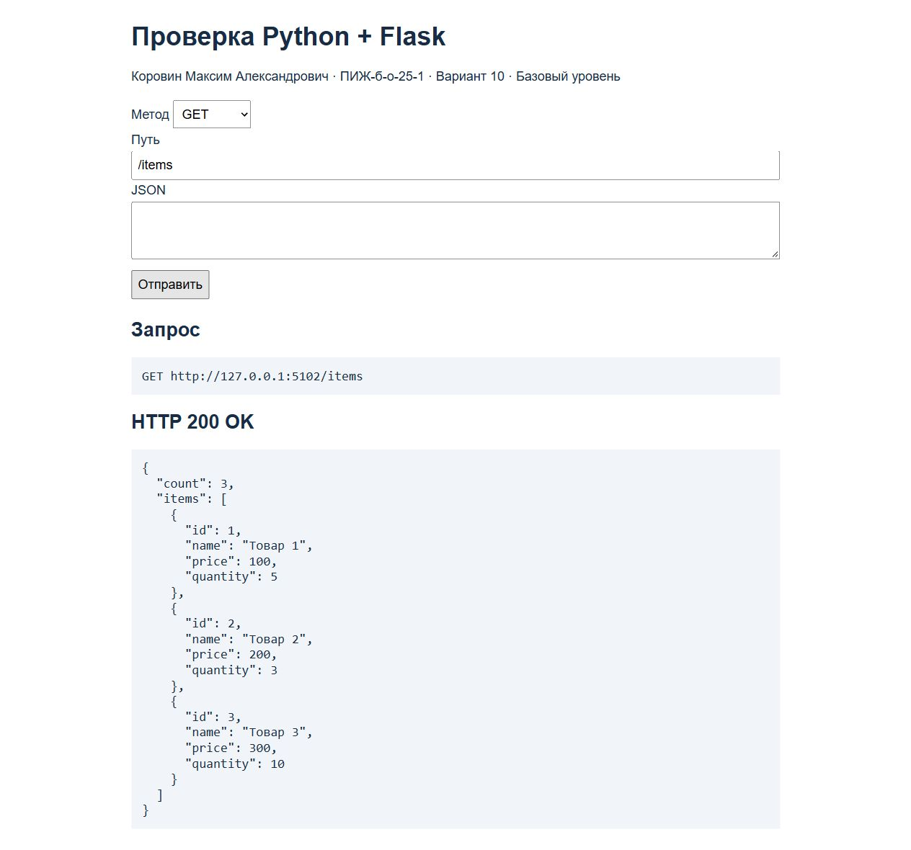

### GET `/items/2` — 200

Получен товар с id=2.

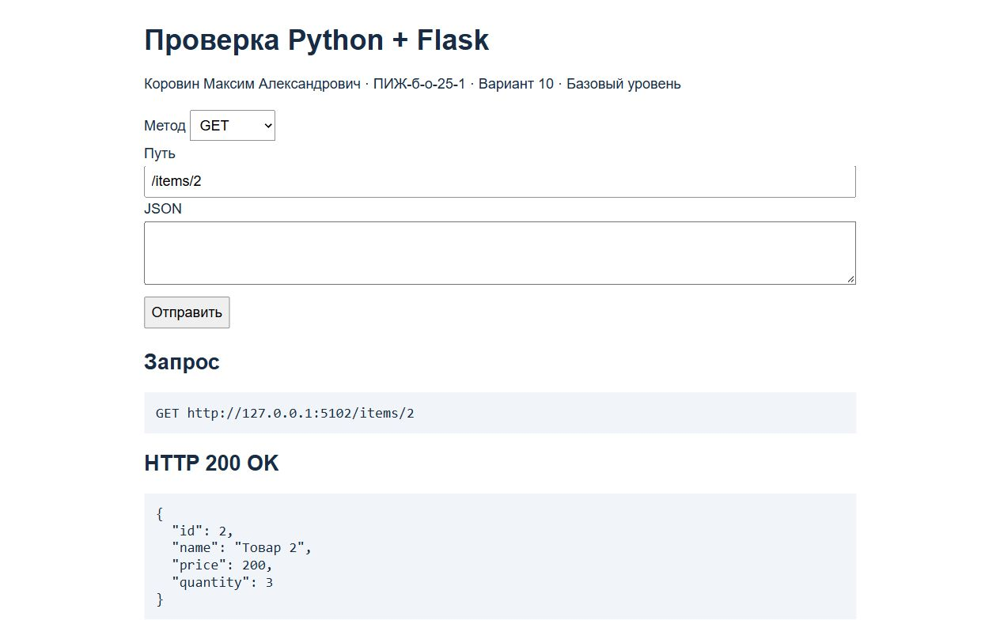

### POST `/items` — 201

Создан товар с id=4, получен код 201.

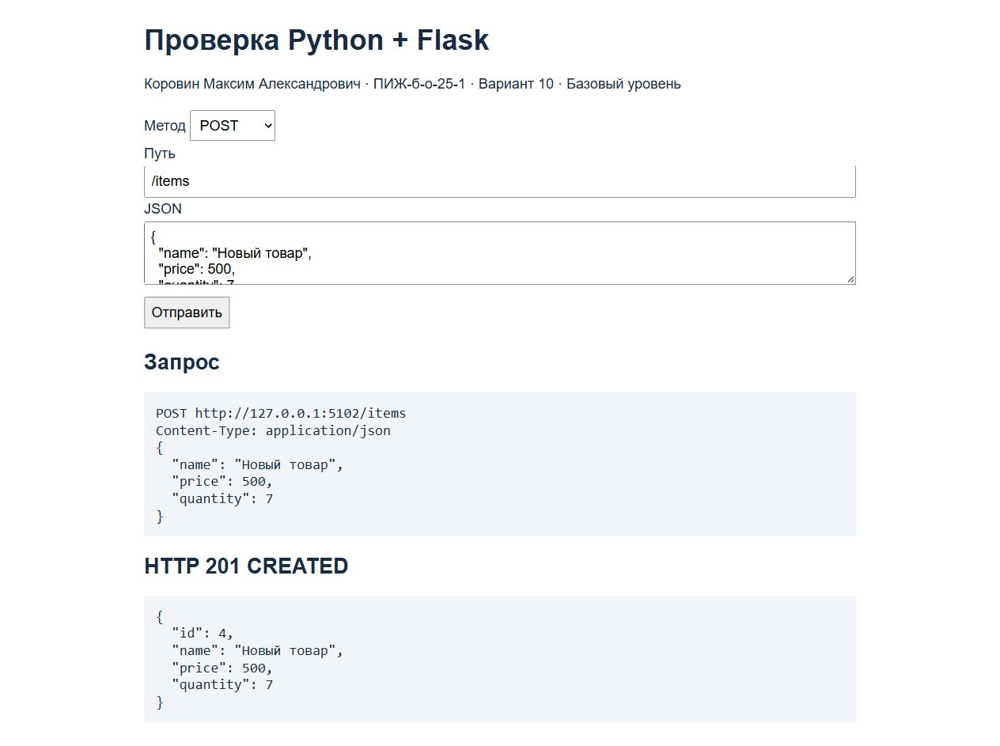

### PUT `/items/1` — 200

Изменены название, цена и количество товара с id=1.

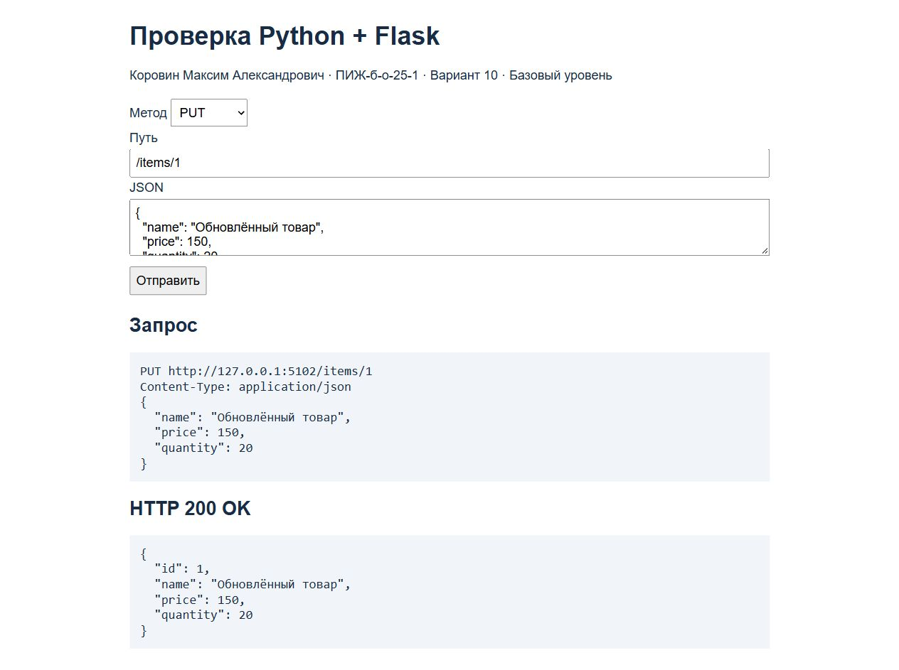

### DELETE `/items/3` — 200

Удалён товар с id=3; ответ содержит удалённый объект.

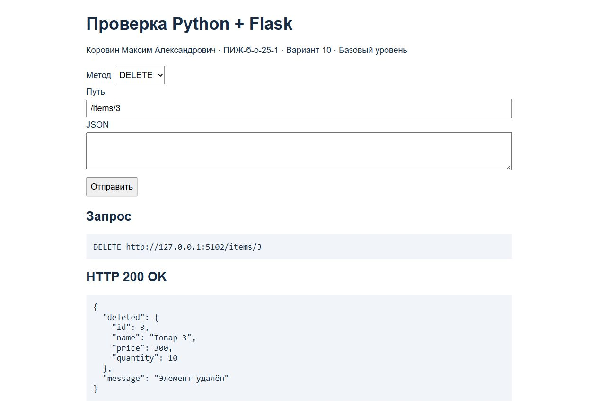

## Выполнение индивидуального задания

Базовый уровень варианта 10: автомобили с полями `id`, `brand`, `model`.

| Метод и маршрут | Назначение | Код успеха |
| --- | --- | --- |
| GET `/cars` | Все автомобили | 200 |
| GET `/cars/<id>` | Один автомобиль | 200 |
| POST `/cars` | Создать автомобиль | 201 |
| PUT `/cars/<id>` | Обновить автомобиль | 200 |
| DELETE `/cars/<id>` | Удалить автомобиль | 200 |

При отсутствии автомобиля возвращается 404. `find_car()` ищет объект по ID. Счётчик `next_id` назначает новые номера и увеличивается при создании. POST и PUT получают `brand` и `model` из JSON-тела. Данные остаются в памяти до перезапуска сервера.

Исходный файл: [app.py](app.py).

```python
from flask import Flask, abort, jsonify, request

app = Flask(__name__)
app.json.ensure_ascii = False

cars = [
    {"id": 1, "brand": "Toyota", "model": "Camry"},
    {"id": 2, "brand": "BMW", "model": "X3"},
    {"id": 3, "brand": "Toyota", "model": "Corolla"}
]
next_id = 4


def find_car(car_id):
    for car in cars:
        if car["id"] == car_id:
            return car
    abort(404)


@app.get("/cars")
def get_cars():
    return jsonify(cars)


@app.get("/cars/<int:car_id>")
def get_car(car_id):
    return jsonify(find_car(car_id))


@app.post("/cars")
def create_car():
    global next_id
    data = request.get_json()
    car = {"id": next_id, "brand": data["brand"], "model": data["model"]}
    cars.append(car)
    next_id += 1
    return jsonify(car), 201


@app.put("/cars/<int:car_id>")
def update_car(car_id):
    car = find_car(car_id)
    data = request.get_json()
    car["brand"] = data["brand"]
    car["model"] = data["model"]
    return jsonify(car)


@app.delete("/cars/<int:car_id>")
def delete_car(car_id):
    car = find_car(car_id)
    cars.remove(car)
    return jsonify(message="Автомобиль удалён", deleted=car)


@app.errorhandler(404)
def not_found(error):
    return jsonify(error="Автомобиль или маршрут не найден"), 404


if __name__ == "__main__":
    app.run(port=5002, debug=True)
```
### GET `/cars` — 200

Получены все три автомобиля из массива.

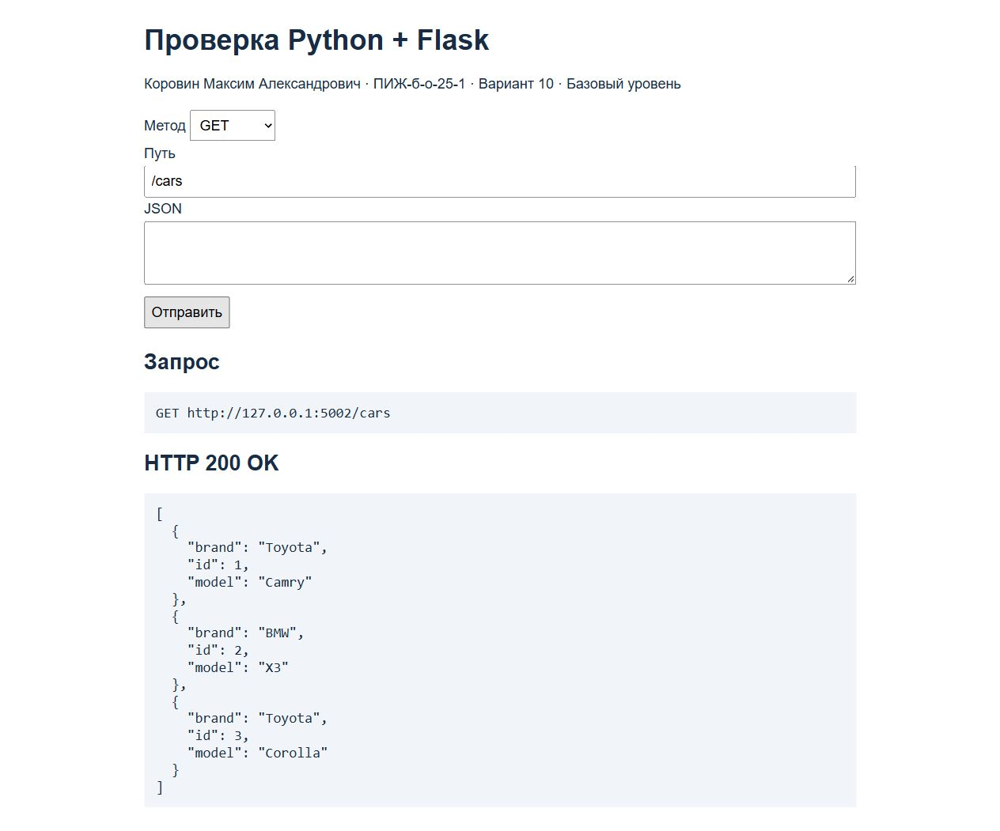

### GET `/cars/2` — 200

Получен BMW X3 с id=2.

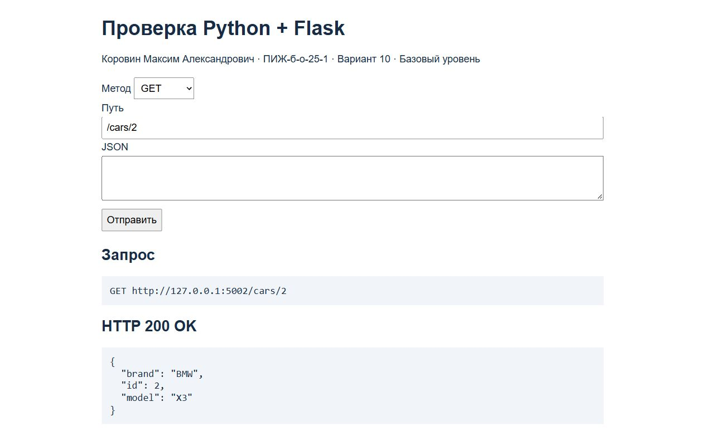

### POST `/cars` — 201

Создан Honda Civic с id=4. ID назначил сервер.

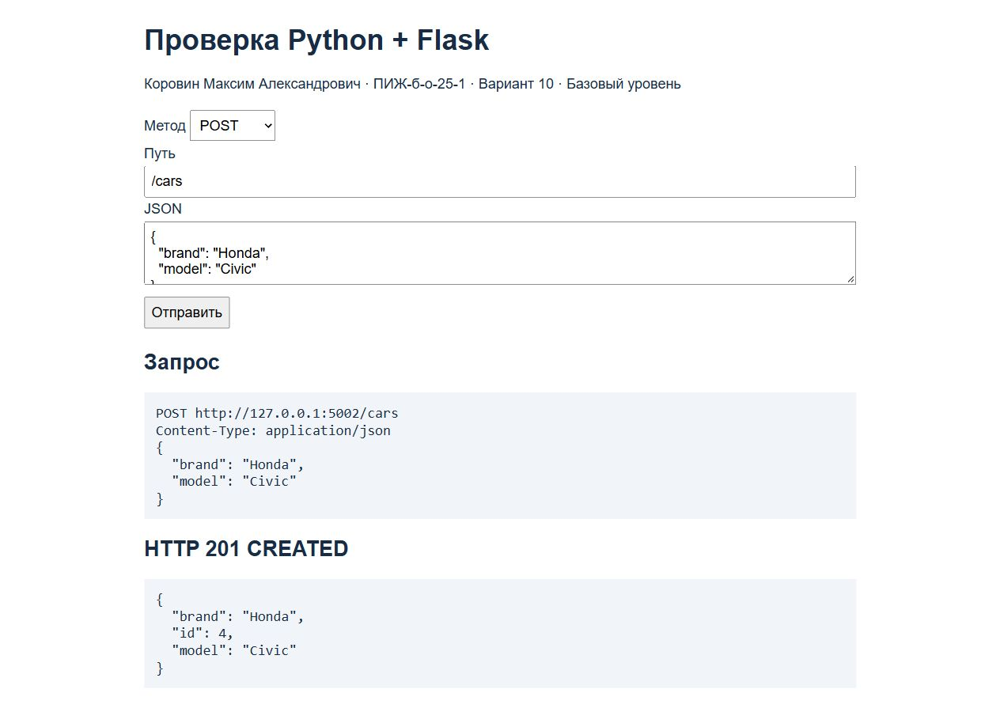

### PUT `/cars/4` — 200

Honda Civic заменён на Honda Accord; id=4 сохранился.

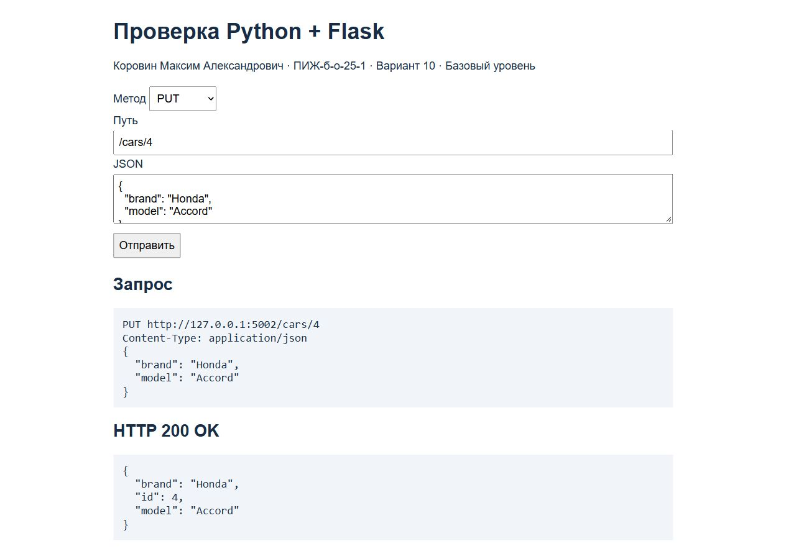

### DELETE `/cars/4` — 200

Автомобиль с id=4 удалён; сервер вернул 200 и удалённый объект.

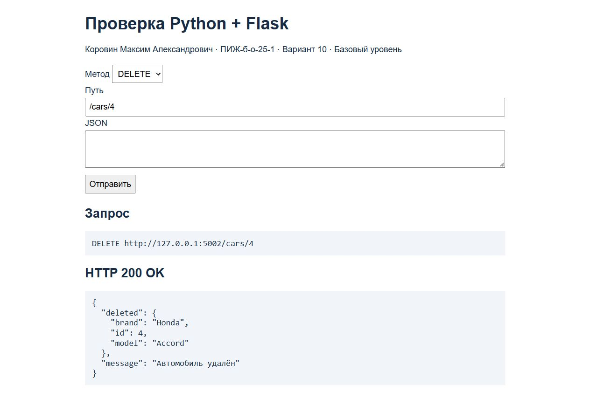

### GET `/cars/4` — 404

После удаления GET /cars/4 возвращает 404.

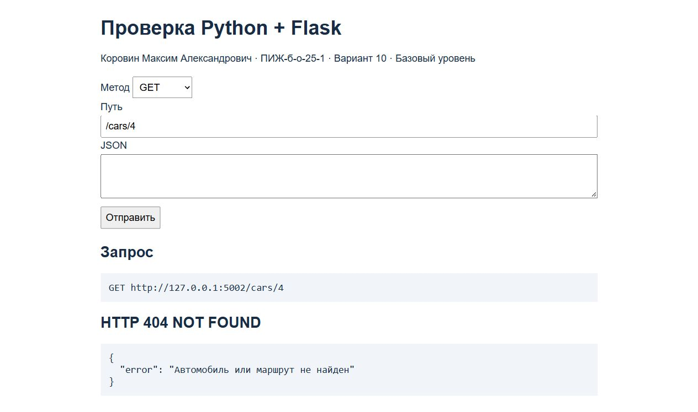

### PUT `/cars/999` — 404

Обновление отсутствующего автомобиля возвращает 404.

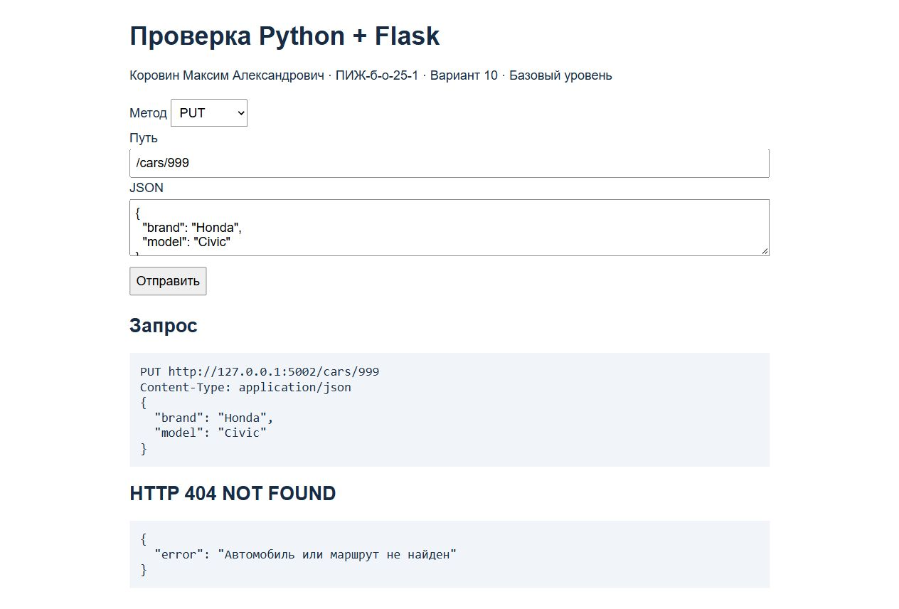

### DELETE `/cars/999` — 404

Удаление отсутствующего автомобиля возвращает 404.

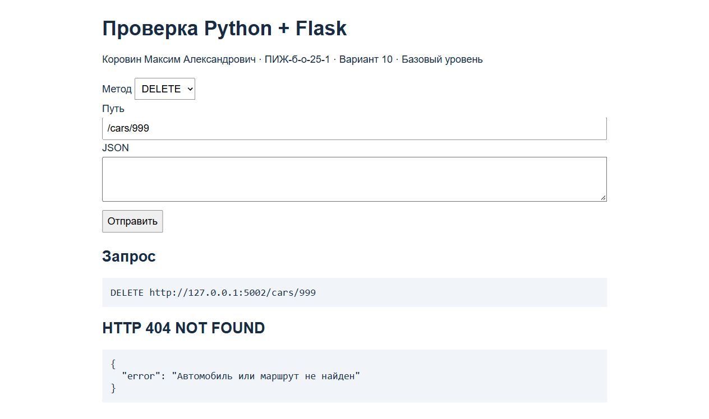

## Проверки и вывод команд

Выполнено **13 запросов curl, все 13 получили ожидаемые коды**. Дополнительно те же запросы выполнены из браузера и сохранены 13 настоящих скриншотов. Снимки не редактировались. На каждом показаны метод, полный URL и полученный HTTP-ответ.

Для повторения проверки нужно заново запустить оба сервера и выполнять команды из [curl_commands.txt](curl_commands.txt) по порядку. Полный настоящий вывод заголовков и JSON-ответов сохранён в [command_output.txt](command_output.txt). Для POST и PUT тела запросов лежат в папке `requests`; в командах используются файлы JSON, чтобы избежать ошибок с кавычками в PowerShell.

Браузерный клиент: `http://127.0.0.1:5002/static/check.html` для индивидуального задания и `http://127.0.0.1:5102/static/check.html` для примера. В нём выбрать метод, указать путь и при необходимости JSON, затем нажать «Отправить». Это обычный клиент [static/check.html](static/check.html): он делает реальный `fetch` к Flask-серверу и выводит ответ. GET-маршруты также можно открыть непосредственно по URL.

Для снимков использован встроенный браузер Codex. Управление Google Chrome остановилось из-за невозможности достоверно определить URL окна; URL самого HTTP-запроса виден в браузерном клиенте.

## Контрольные вопросы

### 1. Что такое CRUD?

Create — создать данные, Read — прочитать, Update — обновить, Delete — удалить.

### 2. Какие HTTP-методы соответствуют CRUD?

POST — создание, GET — чтение, PUT — обновление, DELETE — удаление.

### 3. Какой код возвращается при успешном создании ресурса?

201 Created. Во Flask он задаётся вместе с ответом: `return jsonify(car), 201`.

### 4. Какой код возвращается, если ресурс не найден?

404 Not Found. В работе вызывается `abort(404)`, а обработчик ошибки возвращает JSON и код 404.

### 5. Что произойдёт с данными в памяти при перезапуске сервера?

Изменения потеряются. Python заново создаст список из начальных данных, записанных в `app.py`.

## Вывод

Создан Flask-сервер автомобилей для базового уровня варианта 10 и выполнен практический пример товаров. Проверены создание, чтение, обновление, удаление и ошибки 404. Сохранены реальные ответы curl и 13 скриншотов. Закреплены работа с JSON, связь CRUD с HTTP-методами и хранение данных в списке. При проверке потребовалось учитывать порядок запросов: после создания использовать новый ID, а после удаления ожидать 404.

## Источники

1. «Лабораторная работа №2. HTTP-методы: обработка GET, POST, PUT, DELETE» — предоставленная методичка, базовый уровень варианта 10.
2. [Flask — Quickstart](https://flask.palletsprojects.com/en/stable/quickstart/).
3. [Flask — API](https://flask.palletsprojects.com/en/stable/api/).
