# Лабораторная работа №3: Маршрутизация и параметры пути

**Студент:** Коровин Максим Александрович<br>
**Группа:** ПИЖ-б-о-25-1<br>
**Вариант:** 10<br>
**Уровень:** базовый<br>
**Технология:** Python + Flask<br>
**Дата:** 12 октября 2026 г.

## Цель работы

Освоить маршруты Flask с параметрами пути, получение вложенного ресурса, выбор автомобилей по марке, обработку ошибок 400/404 и автоматический перезапуск сервера.

## Теоретическое обоснование

Маршрутизация сопоставляет HTTP-метод и URL с функцией сервера. Во Flask параметр пути записывается в угловых скобках и передаётся аргументом функции. Например, `/cars/<car_id>` позволяет получить ID из адреса `/cars/1`. Query-параметры находятся после `?`, а JSON-тело передаётся отдельно от URL.

Вложенный маршрут отражает связь ресурсов: `/cars/1/owners` запрашивает владельцев конкретного автомобиля. Маршрут `/brands/Toyota/cars` возвращает автомобили указанной марки. Строковый ID необходимо преобразовать в число перед поиском. Невозможность преобразования означает ошибку 400, отсутствие автомобиля — 404. `debug=True` позволяет Flask автоматически перезапускаться при изменении исходного файла.

## Подготовка и запуск

Из корня репозитория:

```powershell
cd LR_3
python -m pip install -r requirements.txt
python app.py
```

Индивидуальное задание работает по адресу `http://127.0.0.1:5003`.
В другом терминале из той же папки запустить практический пример:

```powershell
python example.py
```

Адрес примера: `http://127.0.0.1:5103`. Остановка сервера — Ctrl+C.
`debug=True` включает автоматический перезапуск после изменения файла.

В папке работы находятся [app.py](app.py), [example.py](example.py), [requirements.txt](requirements.txt),
этот отчёт, [curl_commands.txt](curl_commands.txt), [command_output.txt](command_output.txt),
папки `screenshots`, `requests` и `static`. Все материалы работы находятся вместе.

## Выполнение практического примера

Из Flask-примера методички выполнена базовая часть с городами: общий список, город по ID, площадь города и города страны. Для запуска используется порт 5103.

Исходный файл: [example.py](example.py).

```python
from flask import Flask, abort, jsonify

app = Flask(__name__)
app.json.ensure_ascii = False

cities = [
    {"id": 1, "name": "Москва", "population": 13000000, "country": "Россия", "area": 2561},
    {"id": 2, "name": "Санкт-Петербург", "population": 5600000, "country": "Россия", "area": 1439},
    {"id": 3, "name": "Новосибирск", "population": 1600000, "country": "Россия", "area": 505},
    {"id": 4, "name": "Екатеринбург", "population": 1500000, "country": "Россия", "area": 1112},
    {"id": 5, "name": "Казань", "population": 1250000, "country": "Россия", "area": 425}
]


def find_city(city_id):
    try:
        city_id = int(city_id)
    except ValueError:
        abort(400)
    for city in cities:
        if city["id"] == city_id:
            return city
    abort(404)


@app.get("/cities")
def get_cities():
    return jsonify(count=len(cities), cities=cities)


@app.get("/cities/<city_id>")
def get_city(city_id):
    return jsonify(find_city(city_id))


@app.get("/cities/<city_id>/area")
def get_city_area(city_id):
    city = find_city(city_id)
    return jsonify(city=city["name"], area=city["area"], unit="км²")


@app.get("/countries/<country>/cities")
def get_country_cities(country):
    result = [city for city in cities if city["country"].lower() == country.lower()]
    return jsonify(country=country, count=len(result), cities=result)


@app.errorhandler(400)
def bad_request(error):
    return jsonify(error="ID должен быть числом"), 400


@app.errorhandler(404)
def not_found(error):
    return jsonify(error="Город или маршрут не найден"), 404


if __name__ == "__main__":
    app.run(port=5103, debug=True)
```
### GET `/cities` — 200

Получены пять городов из практического примера.

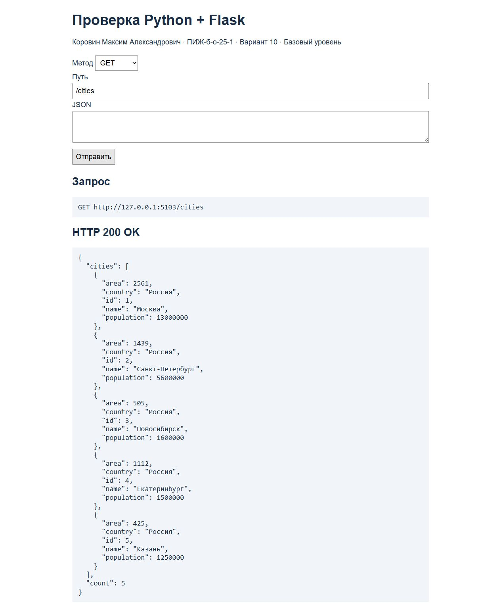

### GET `/cities/1` — 200

Получена Москва с id=1.

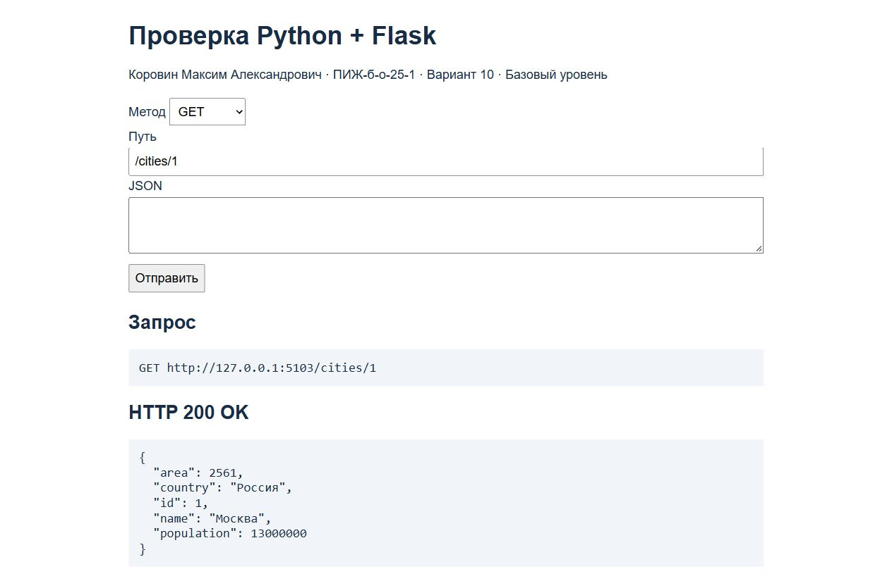

### GET `/cities/1/area` — 200

Получена площадь Москвы: 2561 км².

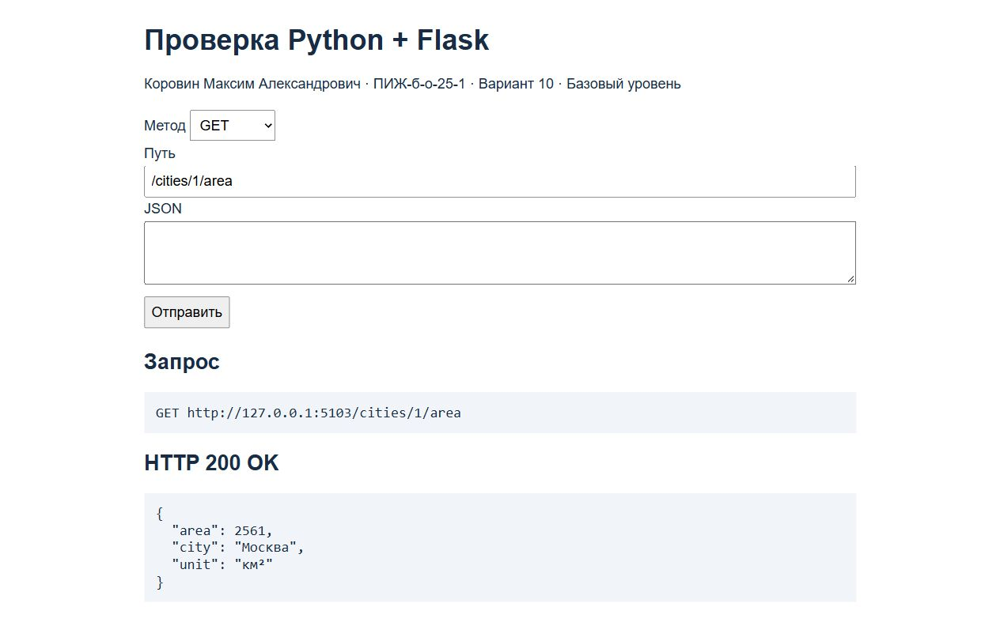

### GET `/countries/Россия/cities` — 200

Получены города страны Россия.

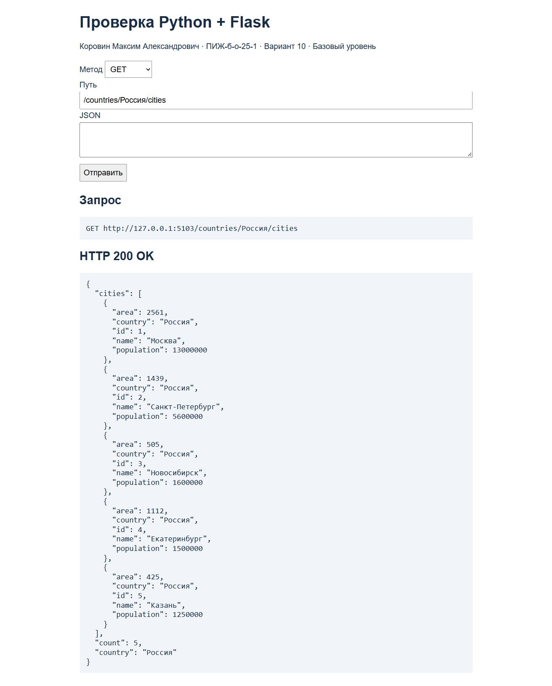

## Выполнение индивидуального задания

Вариант 10 базового уровня: автомобили с полями `id`, `brand`, `model`. Вложенный ресурс — владельцы, категория — марка автомобиля.

| Метод и маршрут | Назначение |
| --- | --- |
| GET `/cars` | Все автомобили |
| GET `/cars/<car_id>` | Автомобиль по ID |
| GET `/cars/<car_id>/owners` | Владельцы автомобиля |
| GET `/brands/<brand>/cars` | Автомобили выбранной марки |

`find_car()` преобразует строковый параметр в число и ищет автомобиль. Строковый маршрут используется специально: с `<int:car_id>` Flask отклонил бы `/cars/abc` как неподходящий путь и вернул 404, тогда как по заданию требуется 400. Марка сравнивается без учёта регистра. Владельцы хранятся отдельно по ID автомобиля.

Исходный файл: [app.py](app.py).

```python
from flask import Flask, abort, jsonify

app = Flask(__name__)
app.json.ensure_ascii = False

cars = [
    {"id": 1, "brand": "Toyota", "model": "Camry"},
    {"id": 2, "brand": "BMW", "model": "X3"},
    {"id": 3, "brand": "Toyota", "model": "Corolla"}
]
owners = {
    1: [{"id": 1, "name": "Иван"}, {"id": 2, "name": "Анна"}],
    2: [{"id": 3, "name": "Максим"}],
    3: []
}


def find_car(car_id):
    try:
        car_id = int(car_id)
    except ValueError:
        abort(400)
    for car in cars:
        if car["id"] == car_id:
            return car
    abort(404)


@app.get("/cars")
def get_cars():
    return jsonify(cars)


@app.get("/cars/<car_id>")
def get_car(car_id):
    return jsonify(find_car(car_id))


@app.get("/cars/<car_id>/owners")
def get_owners(car_id):
    car = find_car(car_id)
    return jsonify(car_id=car["id"], owners=owners[car["id"]])


@app.get("/brands/<brand>/cars")
def get_brand_cars(brand):
    result = [car for car in cars if car["brand"].lower() == brand.lower()]
    return jsonify(brand=brand, cars=result)


@app.errorhandler(400)
def bad_request(error):
    return jsonify(error="ID должен быть числом"), 400


@app.errorhandler(404)
def not_found(error):
    return jsonify(error="Автомобиль или маршрут не найден"), 404


if __name__ == "__main__":
    app.run(port=5003, debug=True)
```
### GET `/cars` — 200

Получены все три автомобиля.

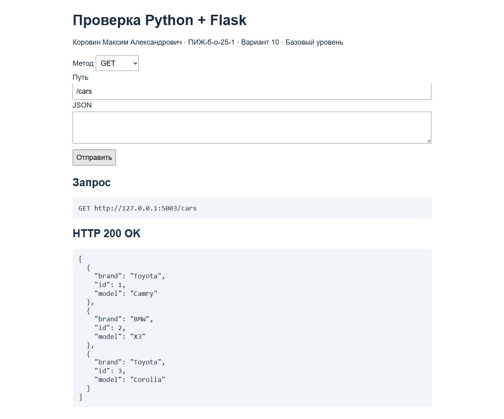

### GET `/cars/1` — 200

Получена Toyota Camry с id=1.

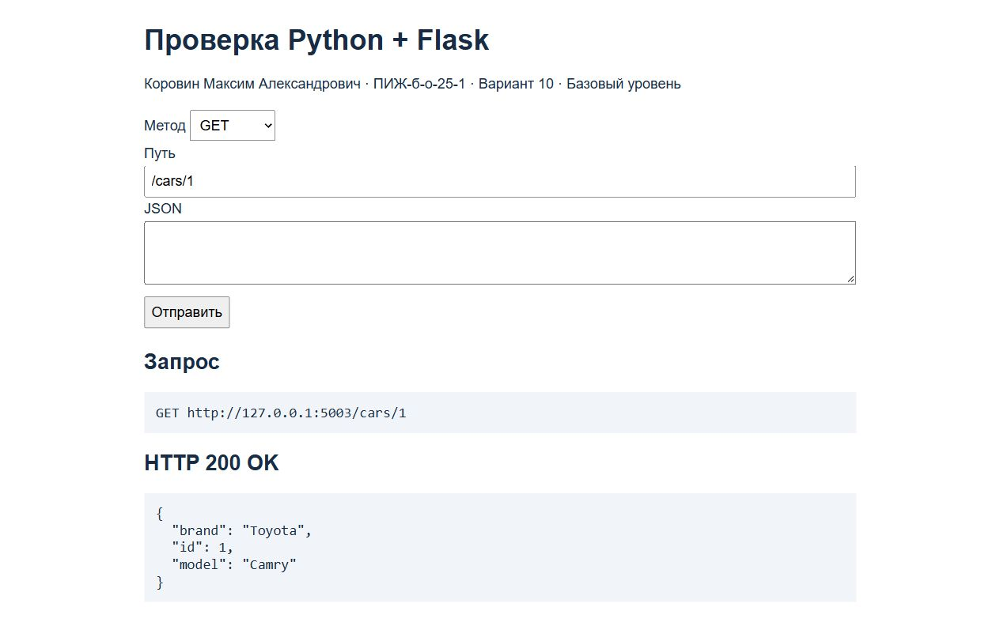

### GET `/cars/1/owners` — 200

Получены два владельца автомобиля с id=1.

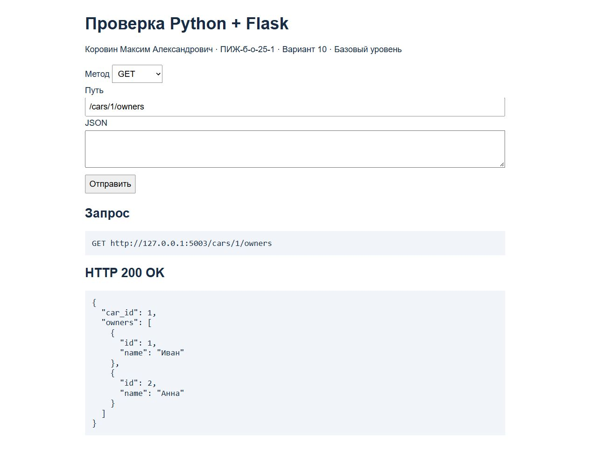

### GET `/brands/Toyota/cars` — 200

Получены только Toyota: автомобили с id=1 и id=3.

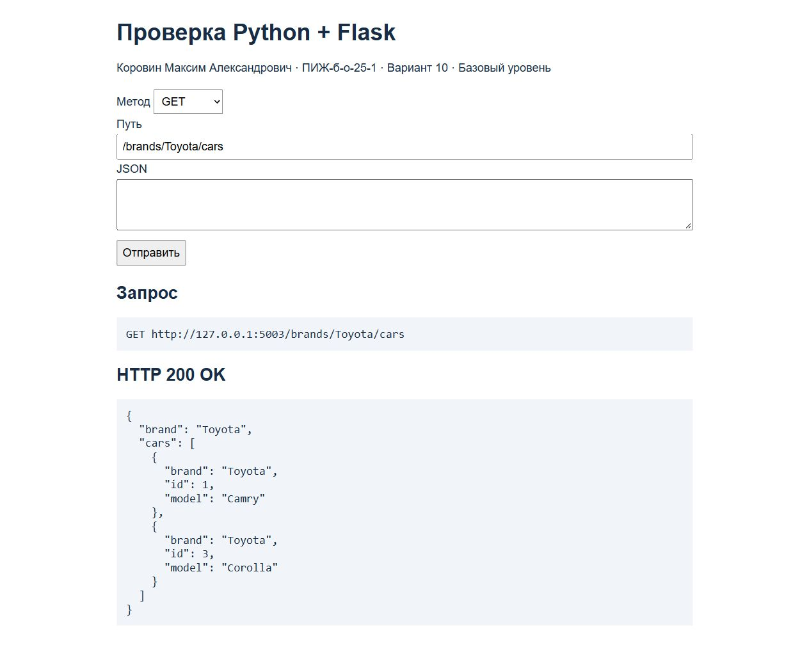

### GET `/cars/abc` — 400

Нечисловой ID abc возвращает 400.

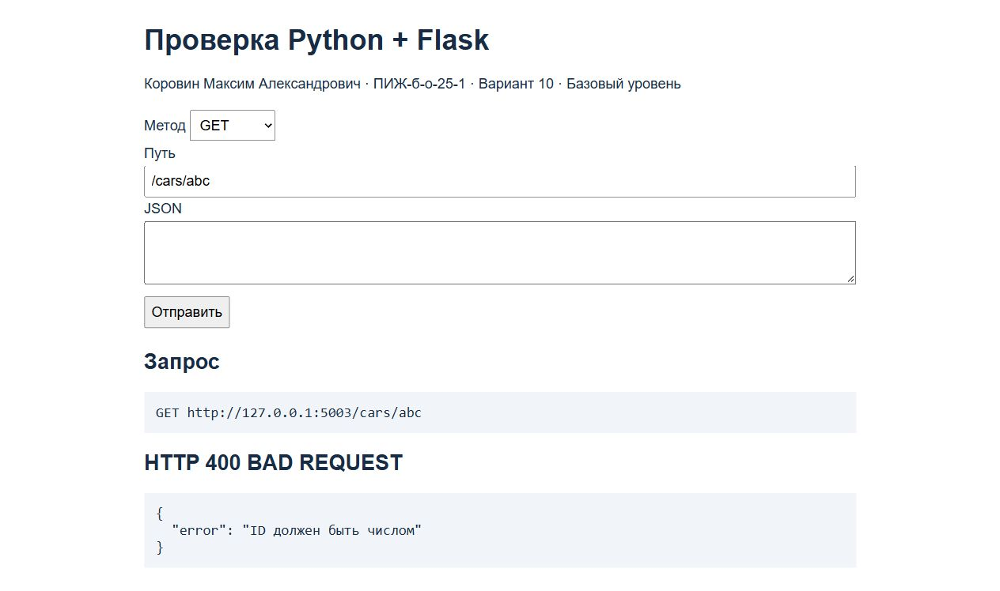

### GET `/cars/abc/owners` — 400

Нечисловой ID во вложенном маршруте также возвращает 400.

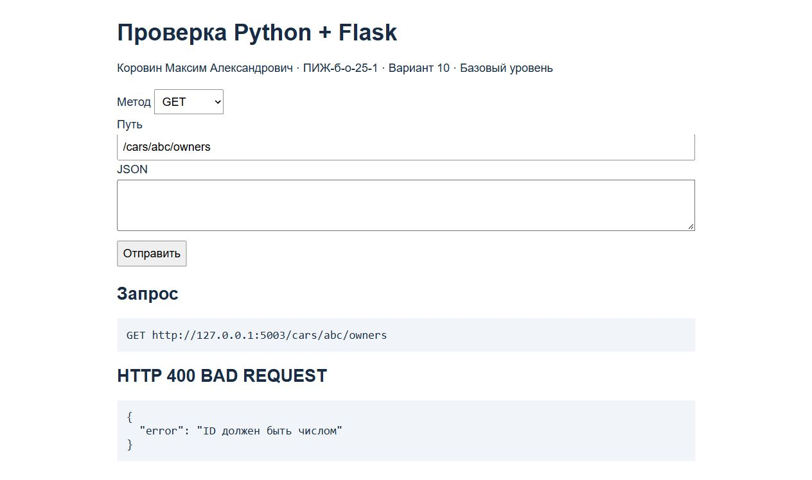

### GET `/cars/999` — 404

Автомобиль с id=999 отсутствует: возвращается 404.

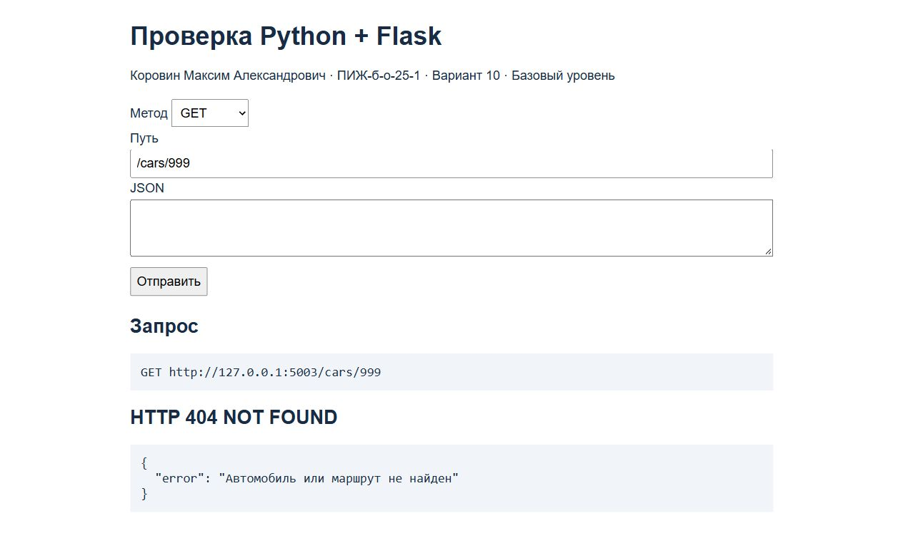

### GET `/cars/999/owners` — 404

Нельзя получить владельцев отсутствующего автомобиля: возвращается 404.


### GET `/cars/3/owners` — 200

Автомобиль существует, но владельцев нет: 200 и пустой список.

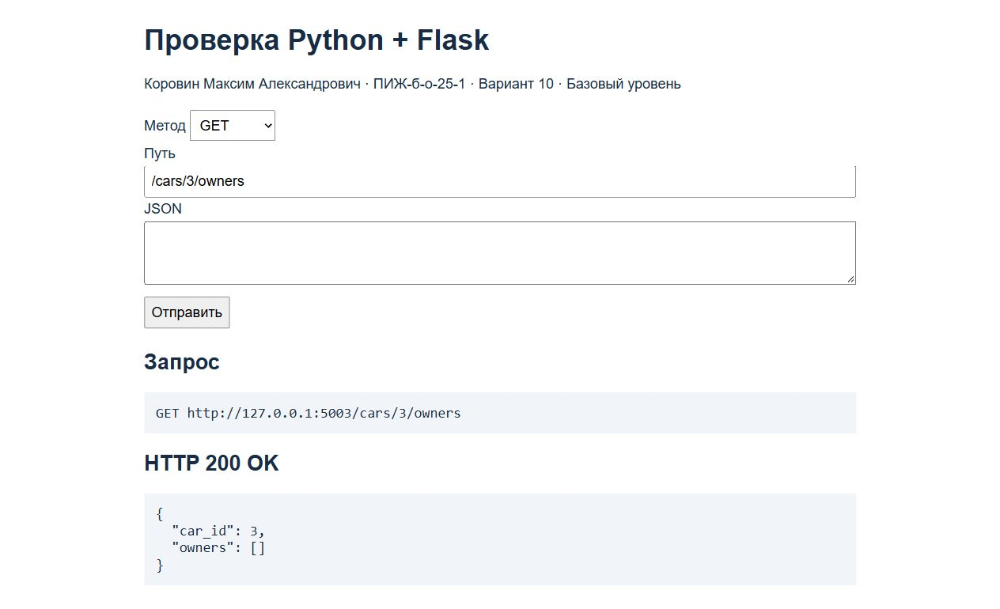

### GET `/brands/Honda/cars` — 200

У марки Honda нет автомобилей в начальном наборе: 200 и пустой список.

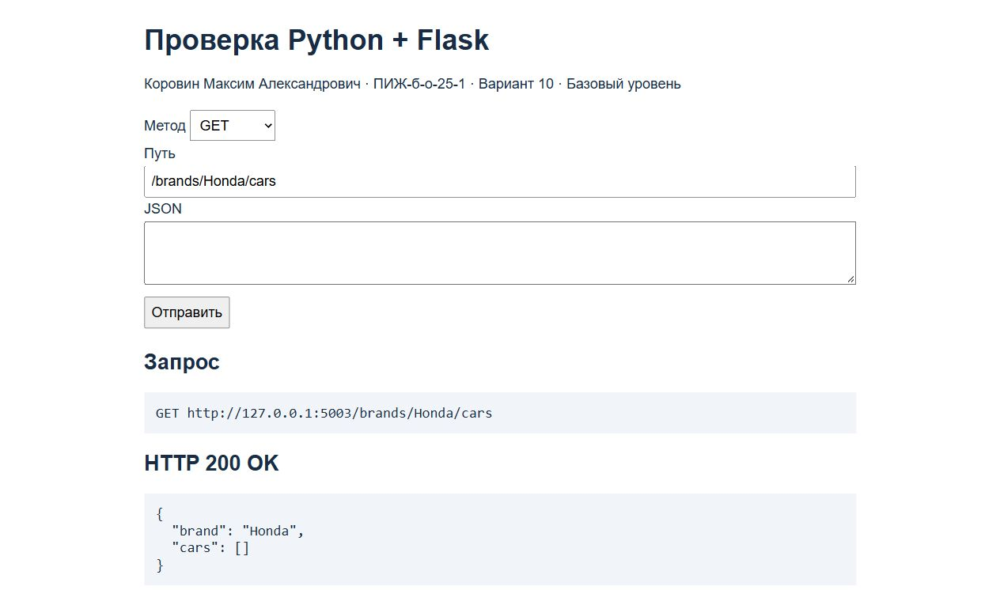

## Проверки и вывод команд

Выполнено **14 запросов curl, все 14 получили ожидаемые коды**. Дополнительно те же запросы выполнены из браузера и сохранены 14 настоящих скриншотов. Снимки не редактировались. На каждом показаны метод, полный URL и полученный HTTP-ответ.

Для повторения проверки нужно заново запустить оба сервера и выполнять команды из [curl_commands.txt](curl_commands.txt) по порядку. Полный настоящий вывод заголовков и JSON-ответов сохранён в [command_output.txt](command_output.txt). Для POST и PUT тела запросов лежат в папке `requests`; в командах используются файлы JSON, чтобы избежать ошибок с кавычками в PowerShell.

Браузерный клиент: `http://127.0.0.1:5003/static/check.html` для индивидуального задания и `http://127.0.0.1:5103/static/check.html` для примера. В нём выбрать метод, указать путь и при необходимости JSON, затем нажать «Отправить». Это обычный клиент [static/check.html](static/check.html): он делает реальный `fetch` к Flask-серверу и выводит ответ. GET-маршруты также можно открыть непосредственно по URL.

Для снимков использован встроенный браузер Codex. Управление Google Chrome остановилось из-за невозможности достоверно определить URL окна; URL самого HTTP-запроса виден в браузерном клиенте.

### Автоматический перезапуск

Проверен запуск с включённой перезагрузкой:

```powershell
python -m flask --app app run --port 5003 --debug --no-debugger
```

После изменения времени сохранения `app.py` Flask обнаружил изменение и перезапустил процесс. Запрос `/cars/1` до и после перезапуска вернул 200 и Toyota Camry. Настоящий вывод запуска и двух curl-запросов находится в [run_output.txt](run_output.txt).

## Контрольные вопросы

### 1. Что такое маршрутизация? Как она работает во Flask?

Это выбор обработчика по методу и пути запроса. Во Flask функция связывается с адресом декоратором, например `@app.get("/cars")`.

### 2. Чем отличаются параметры пути, query-параметры и тело запроса?

Параметры пути — часть адреса, например ID в `/cars/1`. Query-параметры идут после `?` и доступны через `request.args`. Тело передаётся отдельно; JSON можно получить через `request.get_json()`.

### 3. Как получить параметр пути во Flask?

Объявить маршрут `/cars/<car_id>` и аргумент функции `car_id`. Flask передаст в него значение из URL. Тип можно задать конвертером, например `<int:car_id>`.

### 4. Что такое вложенные маршруты?

Это маршруты связанных ресурсов. Например, `/cars/1/owners` возвращает владельцев автомобиля с id=1.

### 5. Какой код возвращается, если ресурс не найден?

404 Not Found. Он возвращается при запросе несуществующего автомобиля или его владельцев.

### 6. Какой код возвращается при невалидном параметре?

400 Bad Request. В работе он возвращается при нечисловом ID, например `/cars/abc`.

## Вывод

Выполнен базовый уровень варианта 10: создан Flask-сервер с четырьмя маршрутами автомобилей, параметрами пути, владельцами и выбором по марке. Выполнена базовая часть практического примера городов. Проверены 14 запросов и сохранены 14 настоящих скриншотов. Проверен автоматический перезапуск. Закреплены передача параметров в функции Flask и различие ошибок 400 и 404. Для получения требуемого 400 при нечисловом ID использован строковый параметр с явным преобразованием в `int`.

## Источники

1. «Лабораторная работа №3. Маршрутизация, параметры пути и query-параметры» — предоставленная методичка, базовый уровень, вариант 10, страница 20.
2. [Flask — маршрутизация](https://flask.palletsprojects.com/en/stable/quickstart/#routing).
3. [Flask — API](https://flask.palletsprojects.com/en/stable/api/).
