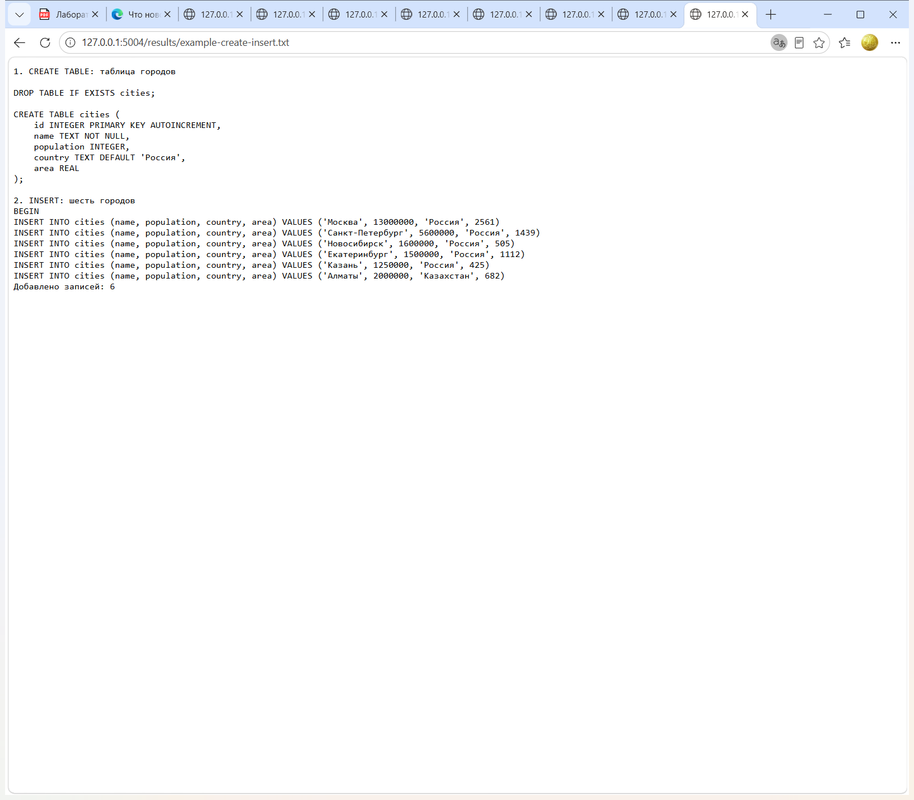
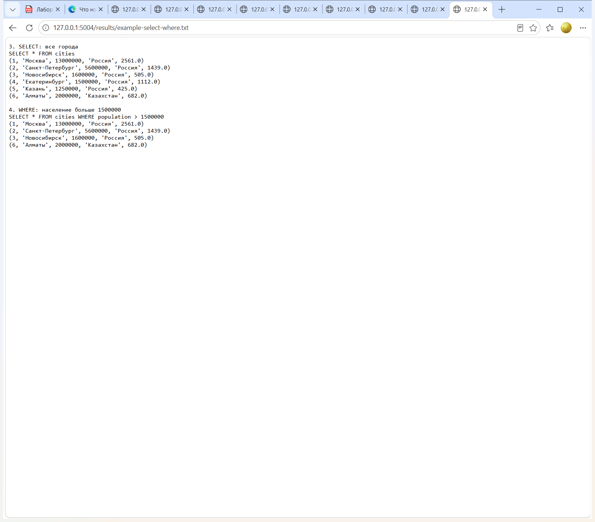
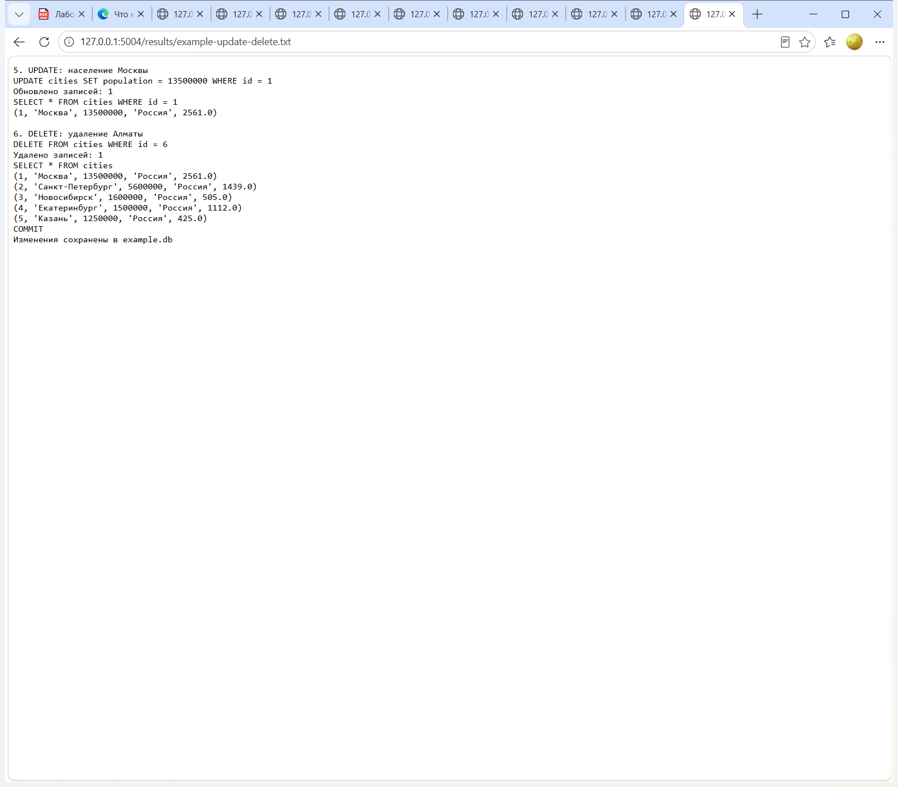
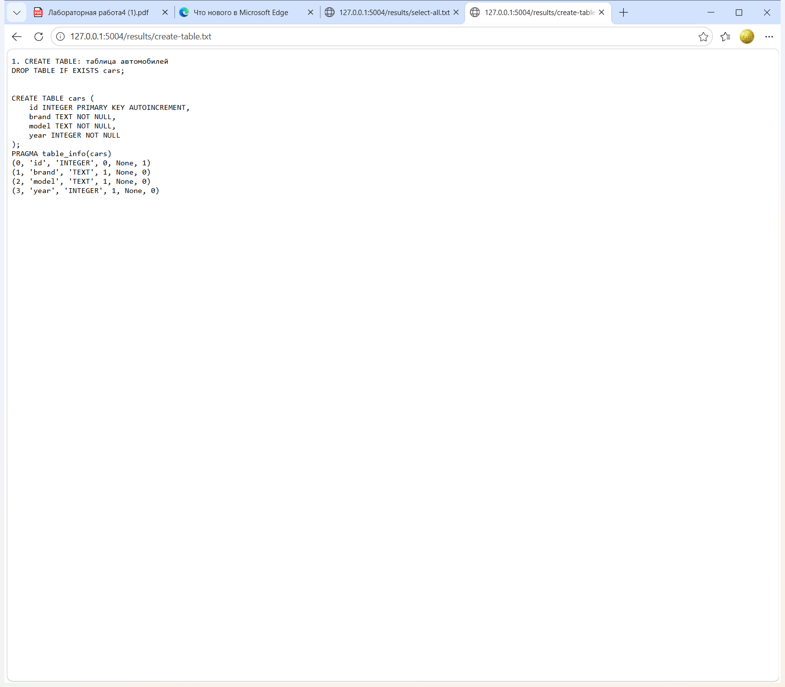
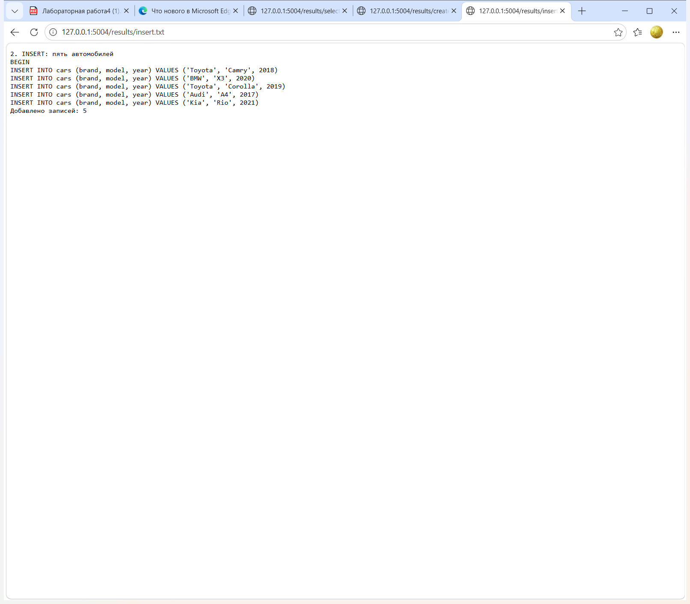
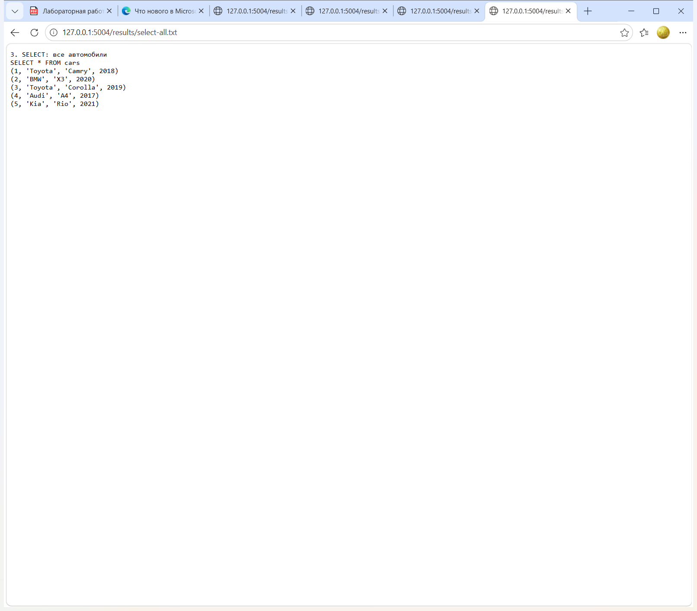
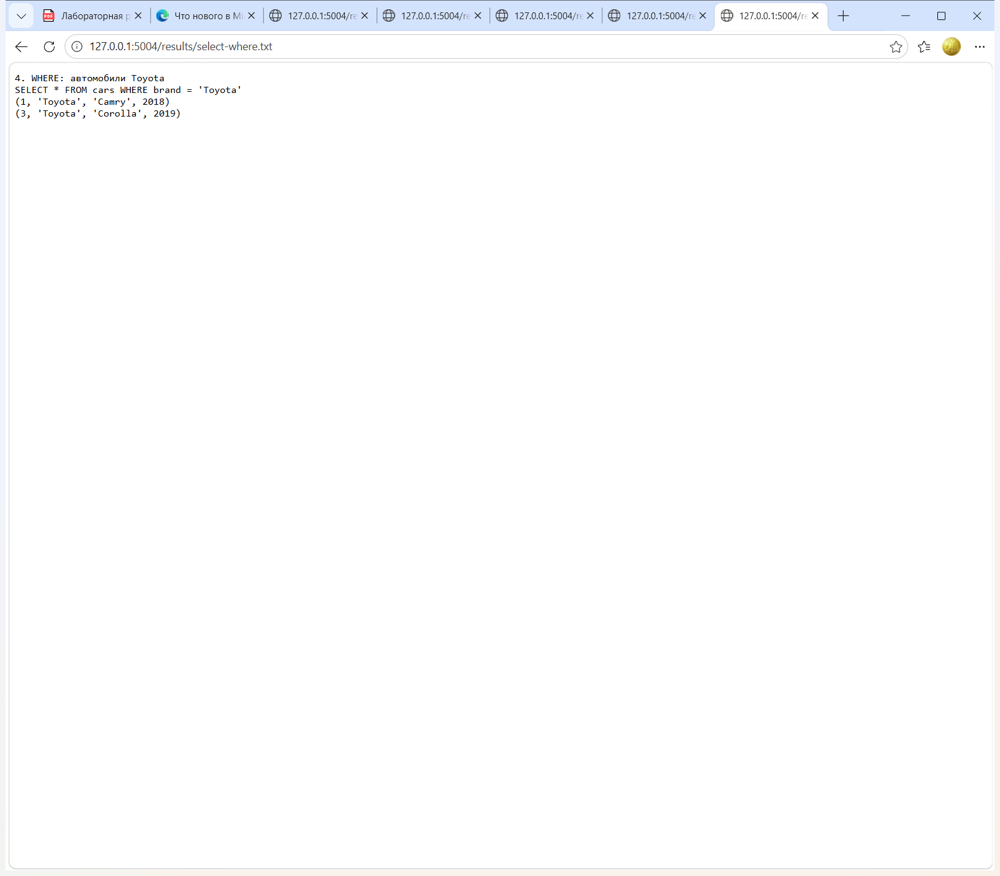
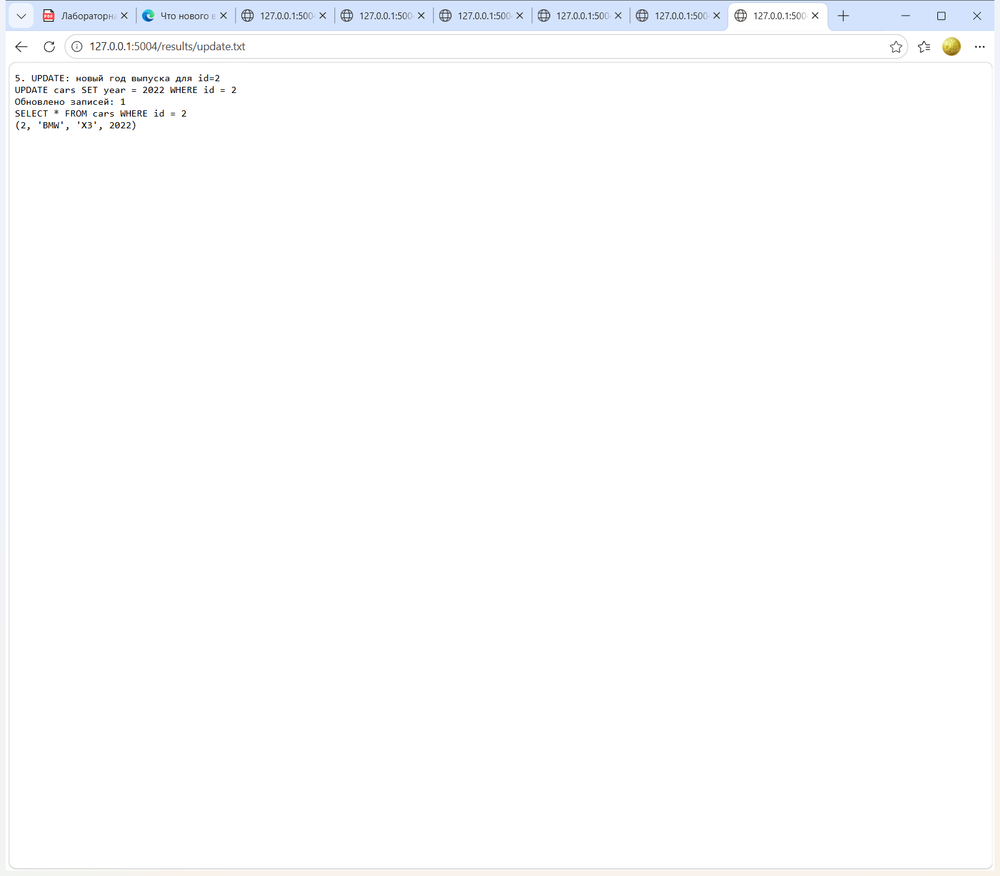
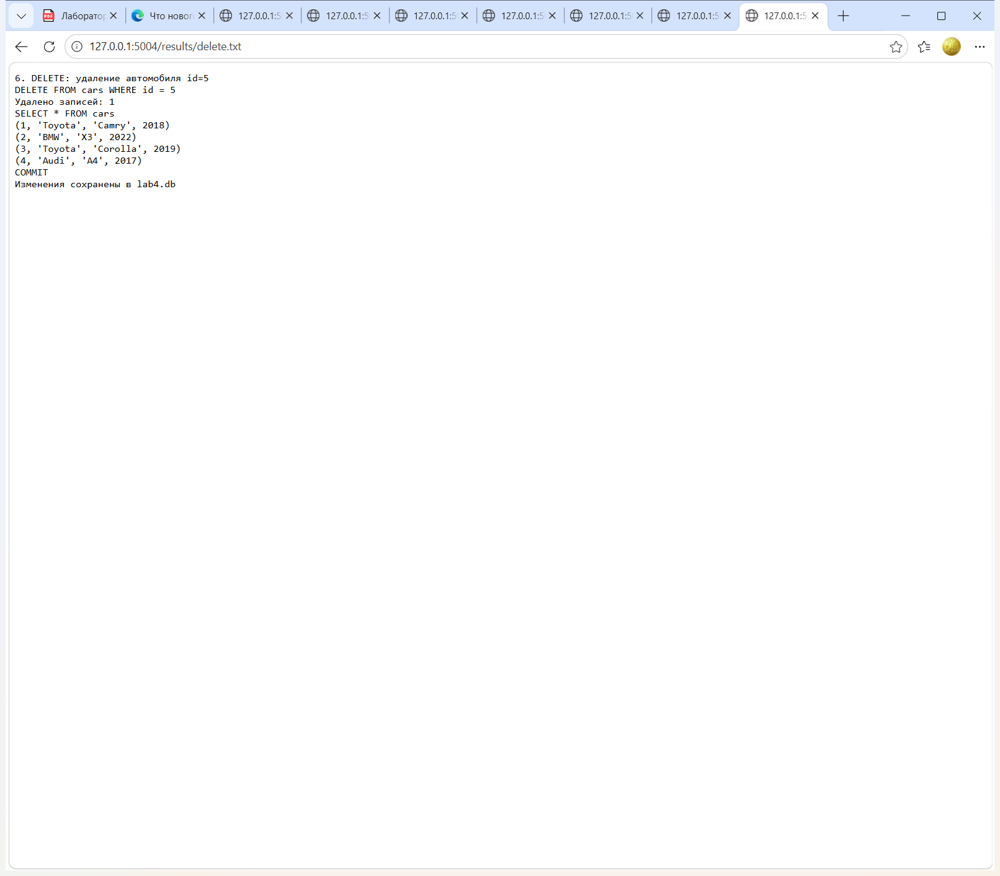

# Лабораторная работа №4: Основы SQL. Работа с SQLite

**Студент:** Коровин Максим Александрович<br>
**Группа:** ПИЖ-б-о-25-1<br>
**Вариант:** 10<br>
**Уровень:** базовый<br>
**Технология:** Python + sqlite3<br>
**СУБД:** SQLite<br>
**Дата:** 24 ноября 2026 г.

## Цель работы

Освоить создание таблицы SQLite и основные операции SQL: INSERT, SELECT, WHERE, UPDATE и DELETE. Научиться сохранять изменения в файле базы данных и проверять результат запросов на примере автомобилей.

## Теоретическое обоснование

SQL — язык запросов к реляционным базам данных. Данные организованы в таблицы со строками и столбцами, а первичный ключ позволяет однозначно определить запись. SQLite хранит базу в локальном файле и работает внутри приложения. В Python доступ к ней предоставляет модуль `sqlite3` стандартной библиотеки. [Документация Python sqlite3](https://docs.python.org/3/library/sqlite3.html).

Команда CREATE TABLE создаёт таблицу, INSERT добавляет строки, SELECT получает данные, UPDATE изменяет строки, DELETE удаляет их. Условие WHERE ограничивает набор обрабатываемых записей. В работе используются типы INTEGER для ID и года выпуска, TEXT для марки и модели. `NOT NULL` требует заполнения поля. [Язык SQL в SQLite](https://www.sqlite.org/lang.html).

Значения передаются в SQL через параметры `?`, отдельно от текста запроса. После изменения данных вызывается `commit()`, затем соединение закрывается через `close()`. При следующем открытии файла сохранённые записи доступны снова. Этим база отличается от списков в памяти из предыдущих работ, которые создавались заново при запуске программы. [Параметры и сохранение изменений](https://docs.python.org/3/library/sqlite3.html).

## Подготовка и запуск

Использованы **Python 3.12.14**, **SQLite 3.53.1**. Дополнительные пакеты устанавливать не требуется.

Из корня репозитория:

```powershell
cd LR_4
python -X utf8 example.py
python -X utf8 db.py
```

`example.py` создаёт файл `example.db` с городами, `db.py` создаёт `lab4.db` с автомобилями. Оба файла находятся рядом со скриптами. При повторном запуске соответствующая учебная таблица пересоздаётся, поэтому данные и ID воспроизводятся без дубликатов. Базы добавлены в [.gitignore](.gitignore) и создаются локально при запуске.

Файлы работы:

| Файл или папка | Назначение |
| --- | --- |
| [db.py](db.py) | Индивидуальное задание |
| [init_db.sql](init_db.sql) | Создание таблицы автомобилей |
| [example.py](example.py) | Практический пример городов |
| [check.py](check.py) | Повторение проверок и сохранение вывода |
| [commands.txt](commands.txt) | Команды запуска и адреса проверок |
| [command_output.txt](command_output.txt) | Полный вывод индивидуального задания |
| [example_output.txt](example_output.txt) | Полный вывод практического примера |
| [checks.txt](checks.txt) | Итог проверок |
| `results/` | Фрагменты настоящего вывода по операциям |
| `screenshots/` | Снимки окна Edge с адресной строкой |

## Выполнение практического примера

Выполнена часть примера городов из методички, соответствующая базовым операциям SQL: создание таблицы, добавление шести городов, выборка, фильтрация, обновление и удаление. Для примера используется отдельная база `example.db`.

Код [example.py](example.py):

```python
from pathlib import Path
import sqlite3

folder = Path(__file__).resolve().parent
connection = sqlite3.connect(folder / "example.db")
cursor = connection.cursor()
connection.set_trace_callback(lambda sql: print(sql.rstrip()))

print("1. CREATE TABLE: таблица городов")
cursor.executescript("""
DROP TABLE IF EXISTS cities;
CREATE TABLE cities (
    id INTEGER PRIMARY KEY AUTOINCREMENT,
    name TEXT NOT NULL,
    population INTEGER,
    country TEXT DEFAULT 'Россия',
    area REAL
);
""")

print("\n2. INSERT: шесть городов")
cities = [
    ("Москва", 13000000, "Россия", 2561),
    ("Санкт-Петербург", 5600000, "Россия", 1439),
    ("Новосибирск", 1600000, "Россия", 505),
    ("Екатеринбург", 1500000, "Россия", 1112),
    ("Казань", 1250000, "Россия", 425),
    ("Алматы", 2000000, "Казахстан", 682)
]
cursor.executemany("INSERT INTO cities (name, population, country, area) VALUES (?, ?, ?, ?)", cities)
print("Добавлено записей:", cursor.rowcount)

print("\n3. SELECT: все города")
cursor.execute("SELECT * FROM cities")
for row in cursor.fetchall():
    print(row)

print("\n4. WHERE: население больше 1500000")
cursor.execute("SELECT * FROM cities WHERE population > ?", (1500000,))
for row in cursor.fetchall():
    print(row)

print("\n5. UPDATE: население Москвы")
cursor.execute("UPDATE cities SET population = ? WHERE id = ?", (13500000, 1))
print("Обновлено записей:", cursor.rowcount)
cursor.execute("SELECT * FROM cities WHERE id = ?", (1,))
print(cursor.fetchone())

print("\n6. DELETE: удаление Алматы")
cursor.execute("DELETE FROM cities WHERE id = ?", (6,))
print("Удалено записей:", cursor.rowcount)
cursor.execute("SELECT * FROM cities")
for row in cursor.fetchall():
    print(row)

connection.commit()
connection.close()
print("Изменения сохранены в example.db")
```

### Создание таблицы и добавление данных

Создана таблица `cities` с полями `id`, `name`, `population`, `country`, `area`. Добавлены Москва, Санкт-Петербург, Новосибирск, Екатеринбург, Казань и Алматы.

Вывод: [results/example-create-insert.txt](results/example-create-insert.txt).



### Выборка и фильтрация

SELECT возвращает шесть городов. Условие `population > 1500000` отбирает Москву, Санкт-Петербург, Новосибирск и Алматы.

Вывод: [results/example-select-where.txt](results/example-select-where.txt).



### Обновление и удаление

Население Москвы изменено на 13 500 000. Алматы с id=6 удалён. Итоговая выборка содержит пять городов, изменения сохранены.

Вывод: [results/example-update-delete.txt](results/example-update-delete.txt).



## Выполнение индивидуального задания

Базовый уровень, вариант 10: **автомобили (`cars`)**, поля **`id`, `brand`, `model`, `year`**. В базе одна пользовательская таблица.

| Поле | Тип | Назначение |
| --- | --- | --- |
| `id` | INTEGER PRIMARY KEY AUTOINCREMENT | Уникальный ID |
| `brand` | TEXT NOT NULL | Марка |
| `model` | TEXT NOT NULL | Модель |
| `year` | INTEGER NOT NULL | Год выпуска |

Схема [init_db.sql](init_db.sql):

```sql
DROP TABLE IF EXISTS cars;

CREATE TABLE cars (
    id INTEGER PRIMARY KEY AUTOINCREMENT,
    brand TEXT NOT NULL,
    model TEXT NOT NULL,
    year INTEGER NOT NULL
);
```

Код [db.py](db.py):

```python
from pathlib import Path
import sqlite3

folder = Path(__file__).resolve().parent
connection = sqlite3.connect(folder / "lab4.db")
cursor = connection.cursor()
connection.set_trace_callback(lambda sql: print(sql.rstrip()))

print("1. CREATE TABLE: таблица автомобилей")
cursor.executescript((folder / "init_db.sql").read_text(encoding="utf-8"))
cursor.execute("PRAGMA table_info(cars)")
for row in cursor.fetchall():
    print(row)

print("\n2. INSERT: пять автомобилей")
cars = [
    ("Toyota", "Camry", 2018),
    ("BMW", "X3", 2020),
    ("Toyota", "Corolla", 2019),
    ("Audi", "A4", 2017),
    ("Kia", "Rio", 2021)
]
cursor.executemany("INSERT INTO cars (brand, model, year) VALUES (?, ?, ?)", cars)
print("Добавлено записей:", cursor.rowcount)

print("\n3. SELECT: все автомобили")
cursor.execute("SELECT * FROM cars")
for row in cursor.fetchall():
    print(row)

print("\n4. WHERE: автомобили Toyota")
cursor.execute("SELECT * FROM cars WHERE brand = ?", ("Toyota",))
for row in cursor.fetchall():
    print(row)

print("\n5. UPDATE: новый год выпуска для id=2")
cursor.execute("UPDATE cars SET year = ? WHERE id = ?", (2022, 2))
print("Обновлено записей:", cursor.rowcount)
cursor.execute("SELECT * FROM cars WHERE id = ?", (2,))
print(cursor.fetchone())

print("\n6. DELETE: удаление автомобиля id=5")
cursor.execute("DELETE FROM cars WHERE id = ?", (5,))
print("Удалено записей:", cursor.rowcount)
cursor.execute("SELECT * FROM cars")
for row in cursor.fetchall():
    print(row)

connection.commit()
connection.close()
print("Изменения сохранены в lab4.db")
```

`set_trace_callback` печатает выполняемые SQL-запросы. Для INSERT, WHERE, UPDATE и DELETE значения передаются параметрами. Перед каждым этапом выводится его название, после выборки — полученные строки, после изменения — число затронутых записей.

### 1. CREATE TABLE

Создана таблица `cars`. Запрос `PRAGMA table_info(cars)` подтвердил четыре поля, их типы и первичный ключ `id`.

Вывод: [results/create-table.txt](results/create-table.txt).



### 2. INSERT

Добавлены пять автомобилей:

| id | brand | model | year |
| --- | --- | --- | --- |
| 1 | Toyota | Camry | 2018 |
| 2 | BMW | X3 | 2020 |
| 3 | Toyota | Corolla | 2019 |
| 4 | Audi | A4 | 2017 |
| 5 | Kia | Rio | 2021 |

`executemany()` выполнил пять INSERT. Выведено `Добавлено записей: 5`.

Вывод: [results/insert.txt](results/insert.txt).



### 3. SELECT всех записей

```sql
SELECT * FROM cars;
```

Получены все пять строк с четырьмя полями.

Вывод: [results/select-all.txt](results/select-all.txt).



### 4. SELECT с WHERE

```sql
SELECT * FROM cars WHERE brand = 'Toyota';
```

Получены только две Toyota: Camry с id=1 и Corolla с id=3. В Python условие записано как `brand = ?`, марка передаётся отдельно.

Вывод: [results/select-where.txt](results/select-where.txt).



### 5. UPDATE одной записи

```sql
UPDATE cars SET year = 2022 WHERE id = 2;
SELECT * FROM cars WHERE id = 2;
```

Обновлена одна запись: год выпуска BMW X3 изменён с 2020 на 2022. Остальные поля и автомобили сохранились.

Вывод: [results/update.txt](results/update.txt).



### 6. DELETE одной записи

```sql
DELETE FROM cars WHERE id = 5;
SELECT * FROM cars;
```

Удалён только Kia Rio с id=5. Остались четыре автомобиля с id=1, 2, 3, 4. В итоговой выборке у BMW X3 указан 2022 год. После `commit()` и закрытия соединения данные сохранены в `lab4.db`.

Вывод: [results/delete.txt](results/delete.txt).



## Контрольные вопросы

### 1. Что такое SQL? Для чего он используется?

SQL — язык запросов для создания таблиц, добавления, чтения, изменения и удаления данных в реляционной базе.

### 2. Что такое SQLite? Чем он отличается от PostgreSQL/MySQL?

SQLite — встраиваемая СУБД с хранением базы в файле. PostgreSQL и MySQL обычно работают как отдельные серверы, к которым подключаются приложения. SQLite удобен для локальных учебных проектов.

### 3. Какие основные типы данных есть в SQLite?

NULL, INTEGER, REAL, TEXT и BLOB. В работе INTEGER хранит числа, TEXT — строки. SQLite использует гибкую типизацию.

### 4. Как создать таблицу? Что такое PRIMARY KEY?

Таблица создаётся командой CREATE TABLE. PRIMARY KEY обозначает первичный ключ, который однозначно определяет строку. В таблице автомобилей ключом служит `id`.

### 5. Как вставить данные? Что делает INSERT?

INSERT добавляет строку. Например, `INSERT INTO cars (brand, model, year) VALUES ('Toyota', 'Camry', 2018);`. В Python несколько строк удобно добавить через `executemany()`.

### 6. Как выбрать все данные из таблицы?

Запросом `SELECT * FROM cars;`. Символ `*` означает все столбцы.

### 7. Как выбрать данные с условием? Что такое WHERE?

WHERE задаёт условие отбора. Например, `SELECT * FROM cars WHERE brand = 'Toyota';` возвращает только автомобили этой марки.

### 8. Как обновить данные? Что делает UPDATE?

UPDATE изменяет значения существующих строк. Например, `UPDATE cars SET year = 2022 WHERE id = 2;`. WHERE ограничивает изменение одной записью.

### 9. Как удалить данные? Что делает DELETE?

DELETE удаляет строки, соответствующие условию. Например, `DELETE FROM cars WHERE id = 5;`. Без WHERE команда затронет все строки таблицы.

### 10. Что такое AUTOINCREMENT?

В сочетании с INTEGER PRIMARY KEY это автоматическое назначение ID без повторного использования ID ранее удалённых строк в той же таблице. В учебном скрипте таблица при новом запуске создаётся заново, поэтому её нумерация начинается с 1. [SQLite AUTOINCREMENT](https://www.sqlite.org/autoinc.html).

## Вывод

Выполнен базовый уровень варианта 10: создана таблица автомобилей, добавлены пять записей, выполнены SELECT, WHERE, UPDATE и DELETE. Выполнен практический пример городов в части базовых SQL-операций. Сохранены вывод команд и десять настоящих снимков браузера с URL. Все 14 проверок пройдены.

Освоены параметризованные запросы и сохранение изменений через `commit()`. Установлено, что данные SQLite остаются в файле после закрытия программы. При подготовке повторного запуска потребовалось пересоздавать учебную таблицу: простое удаление строк не сбрасывает AUTOINCREMENT, что мешало бы повторять проверки с теми же ID.


